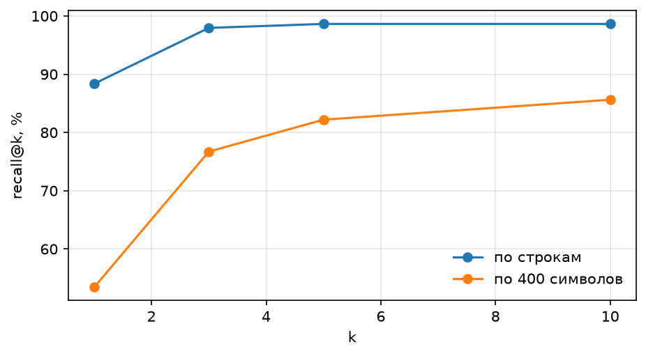
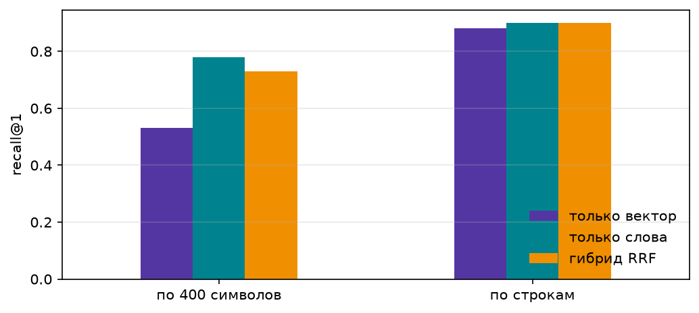

# ДЗ2 · RAG, Milvus и память агента

## Корпус

Вариант A: полные тексты wiki-страниц из вопросов ДЗ1.


| Файл                                                 | Содержание                           |
| ---------------------------------------------------- | ------------------------------------ |
| `[data/corpus_2026.jsonl](data/corpus_2026.jsonl)`   | 30 страниц, ~845k символов           |
| `[data/questions.jsonl](data/questions.jsonl)`       | 146 вопросов с `evidence` в корпусе  |
| `[data/unanswerable.jsonl](data/unanswerable.jsonl)` | 10 вопросов без ответа в корпусе     |
| `[data/pdf/](data/pdf/)`                             | PDF для бонуса (лекции + homework01) |


Сборка: `python fetch_corpus.py`.

### Нарезки

1. **По строкам (осмысленная):** граница куска = непустая строка ≥40 символов обзорной wiki-страницы — факты 2026 там уже лежат построчно с датой. Получилось **5839** кусков (≥300).
2. **Наивная:** окна по 400 символов → 2122 куска.


## Поиск и индекс

Milvus: **Lite** (`milvus_lite.db`) — `docker-compose.yml` лежит в корне для локального сервера (`docker compose --profile ui up -d`).

Эмбеддинги: `openai/text-embedding-3-small` dim=512, кэш `[emb_cache.npz](emb_cache.npz)` (~8 МБ).

Фильтр: `page == "2026 in Japan"` — см. демо в `hw2.py --index`.

### recall@k




| нарезка         | @1   | @3   | @5       | @10  |
| --------------- | ---- | ---- | -------- | ---- |
| по строкам      | 0.88 | 0.98 | **0.99** | 0.99 |
| по 400 символов | 0.53 | 0.77 | 0.82     | 0.86 |


**Выбор k=5:** на построчной нарезке recall@5 почти saturates; дальше контекст дорожает почти без роста покрытия.

### Гибрид RRF




| нарезка                  | только вектор | только слова | гибрид RRF |
| ------------------------ | ------------- | ------------ | ---------- |
| по строкам recall@1      | 0.88          | 0.90         | **0.90**   |
| по строкам recall@5      | 0.99          | 0.98         | **1.00**   |
| по 400 символов recall@1 | 0.53          | 0.78         | 0.73       |


На строках вектор уже сильный; RRF дожимает recall@5 до 1.00.

## Замер ответов (n=146)

Скрипт: `python hw2.py --eval`. Картинка: `[img/money_rag.png](img/money_rag.png)`.


| Конфигурация                    | model       | accuracy | cost/q   | cost/correct |
| ------------------------------- | ----------- | -------- | -------- | ------------ |
| сильная, без инструментов       | sonnet-4.6  | 0.01     | $0.00103 | $0.07539     |
| дешёвая, живой поиск ДЗ1        | gpt-4o-mini | 0.61     | $0.00057 | $0.00094     |
| дешёвая, RAG всегда             | gpt-4o-mini | 0.87     | $0.00006 | $0.00007     |
| дешёвая, агент с knowledge_base | gpt-4o-mini | **0.89** | $0.00013 | $0.00014     |
| средняя, RAG всегда             | haiku-4.5   | **0.93** | $0.00064 | $0.00068     |


Живой поиск — тот же цикл, что в `agent.py`: `web_search` и `page_find`, повтор вызова и лимит 8 шагов. Цена строки — `Run.cost`. На всех 146 вопросах это 61%, а не один поиск без цикла.

Сетевой сбой (`ConnectionError`, `Timeout`, `RuntimeError`) повторяется ещё два раза. Если попытки кончились, строка не входит в accuracy и не считается `search_miss`. В этом прогоне таких строк не было: у каждой конфигурации n=146. Запросы шли по одному.

Инструмент `knowledge_base`: схема + описание + тесты (нормальный / пустой / ошибка фильтра) в `[hw2.py](hw2.py)`. Пустой поиск — `knowledge_base("anything", page="ThisPageDoesNotExistXYZ")`, ответ ровно `nothing found`.

### Отказы (RAG, cheap)


|                              |              |
| ---------------------------- | ------------ |
| unanswerable отказано честно | **10 / 10**  |
| answerable ложно отказано    | 8 / 146      |


Десять вопросов в `data/unanswerable.jsonl` свои: Indianapolis 500, Ballon d'Or, Booker Prize, цена Bitcoin, Prix de Lausanne, выборы президента Франции 2027, Hugo Award, места Pirate Party, Scripps Spelling Bee, фильм Glass Onion 2. Этих ответов в корпусе нет.


### Два провала (лучшая дешёвая — агент с knowledge_base)

Из `[failures_rag.json](failures_rag.json)`, кучки: search_miss=3, found_but_wrong=13.

1. **Поиск не нашёл** — `fresh-8` («Who was charged by the FSB in Russia on 29 July 2026?», эталон Pavel Durov). Агент ответил `NOT_FOUND`, и в строках его вызовов нет золотого куска. Прямой поиск по тексту вопроса эту строку со страницы `2026 in Russia` возвращает, значит запрос агента ушёл мимо. Чинить: класть в запрос дату и имя из вопроса и не писать `NOT_FOUND`, пока в выдаче есть строка с той же датой.
2. **Нашёл, но ответ неверный** — `fresh-0` (бойкот закрытия Паралимпиады, страница `2026 in Ukraine` в выдаче была). Эталон `15 March`, ответ `March 15, 2026`. После `norm` проверка ищет фразу `15 march` внутри `march 15 2026` и не находит: день и месяц стоят в другом порядке. Чинить: в `is_correct` принимать оба порядка даты.


## Память

- Эпизодическая: `[episodes.jsonl](episodes.jsonl)` (в `.gitignore`).
- Семантическая: коллекция `facts` в Milvus; замена факта, а не дубль.
- Демо: сессия 1 — «Аня, Берлин»; сессия 2 без истории отвечает про Берлин; после «переехала в Париж» в памяти Paris. См. `[memory_demo.json](memory_demo.json)`.
- Тесты без LLM: пустая коллекция `facts` → `recall_facts("Where do I live?") == []`, затем найденный Berlin и замена на Paris.
- Токены: `[img/tokens_memory.png](img/tokens_memory.png)` — после каждого `talk` берётся `prompt_tokens` последнего вызова с тегом `dialog:…`, вместе с источниками, которые модель видела. Полная история растёт с 85 до 1866 токенов ($0.0015), окно+факты остаётся в диапазоне 106–604 ($0.0008).


## Бонусы


### Parent-chunk (±2 соседние строки)


| режим  | recall@1 | recall@5 | RAG accuracy (n=20) |
| ------ | -------- | -------- | ------------------- |
| child  | 0.82     | 0.97     | **0.90**            |
| parent | **0.90** | 0.97     | 0.85                |


Parent поднимает recall@1, но чуть снижает accuracy RAG (в контекст попадает шум) и дороже.

### PDF со ссылкой на страницу

Индекс `course` по `data/pdf/`. В ответе цитата вида `(homework01.pdf, стр. 2)`:

- «Что такое RRF?» → lecture06.pdf, стр. 14
- «Доля Sonnet по свежести?» → **20 процентов** (homework01.pdf, стр. 2)


## Вывод по тезису

На этом корпусе тезис **подтверждается ещё сильнее, чем на прошлой неделе**:

- сильная без инструментов ~1%;
- живой поиск ДЗ1 (полный цикл `web_search` + `page_find`) ~61% и дороже RAG: $0.00057 против $0.00006 за вопрос;
- дешёвый RAG / агент с KB: **87–89%** при цене вопроса ≪ цента;
- средняя модель с RAG даёт 93%, но cost/correct примерно в 5 раз выше агента на mini.

Верный ответ стал дешевле прошлой недели за счёт локального индекса (меньше шагов, короче контекст, чем page_find по живой wiki) и кэша эмбеддингов.

## Запуск с чистого клона

```bash
python3 -m venv .venv && source .venv/bin/activate
pip install -r requirements.txt
cp .env.example .env   # OPENROUTER_API_KEY=

# опционально полный Milvus:
# docker compose --profile ui up -d

python fetch_corpus.py
python hw2.py --index
python hw2.py --eval          # все 146 вопросов
python hw2.py --memory
python hw2.py --bonuses
# или: python hw2.py --all
```

Ноутбук с заполненными дырками: `[rag.ipynb](rag.ipynb)`. Основной воспроизводимый конвейер — `[hw2.py](hw2.py)`.